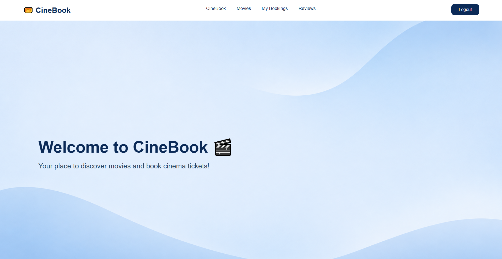
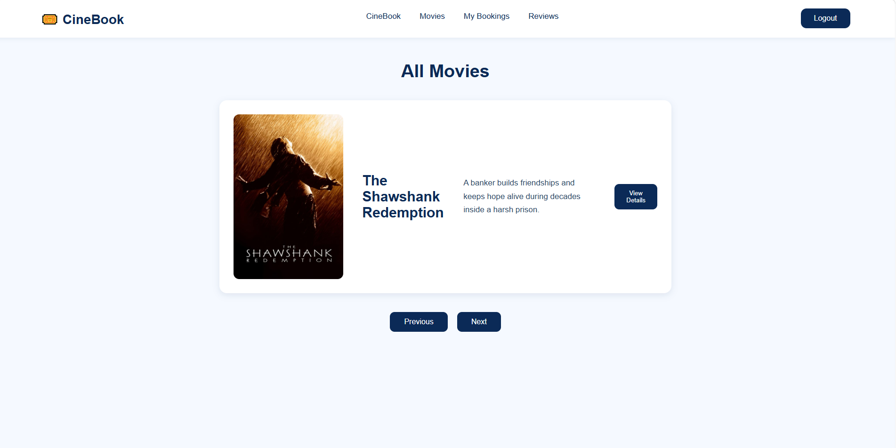
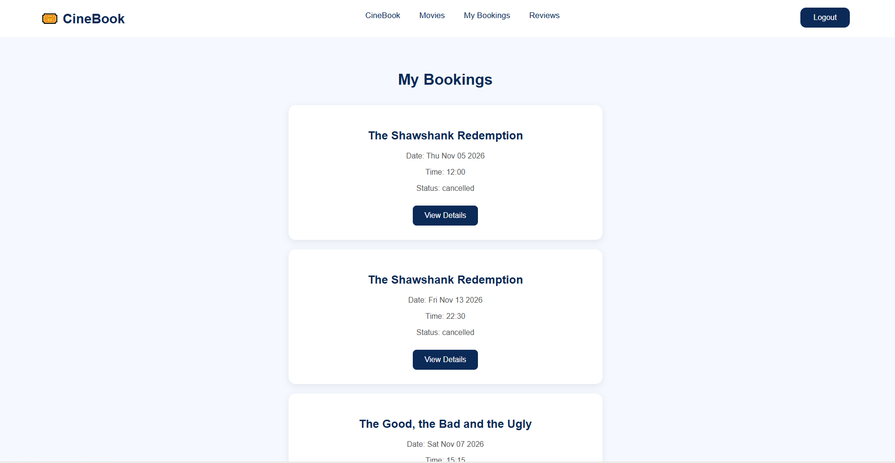
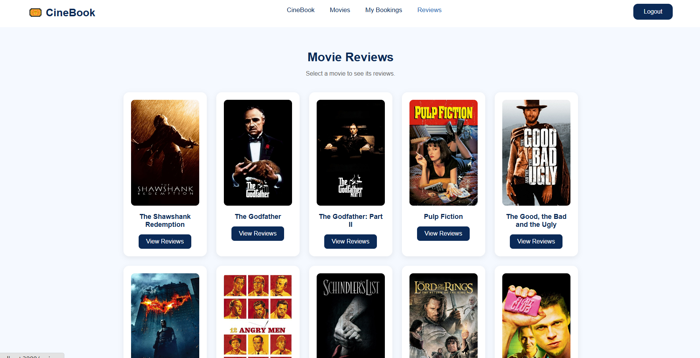

# Cinema Booking System 

## Overview

CineBook is a cinema booking web application that allows users to browse available movies, view movie details, select showtimes, and reserve their preferred seats.

Users can create an account, log in, manage their bookings, and cancel reservations. The system prevents users from booking seats that are already reserved for the same showtime.

Users can also rate movies and write reviews, with the ability to edit or delete their own reviews.

The application is designed for a single cinema, providing a simple and user-friendly movie booking experience.

## Screenshots

## Technologies Used

## Getting Started

## User Stories
* As a user, I want to sign up and log in so that I can access my account and book movie tickets.
* As a user, I want to browse available movies so that I can choose a movie to watch.
* As a user, I want to view movie details so that I can see the description, genre, and available showtimes.
* As a user, I want to select a showtime and an available seat so that I can reserve a movie ticket.
* As a user, I want to view my bookings so that I can check my reserved movies, showtimes, and seats.
* As a user, I want to cancel my booking so that I can change my plans if needed.
* As a user, I want to rate a movie and write a review so that I can share my opinion.
* As a user, I want to view, edit, and delete my own reviews so that I can manage my feedback.

## Database Design

## Routes

| Method | Route | Description |
|---------|-------|-------------|
| GET | / | Home page |
| GET | /listings | List all listings |
| GET | /listings/new | New listing form |
| POST | /listings | Create listing |
| GET | /listings/:id | View listing |
| GET | /listings/:id/edit | Edit listing form |
| PUT | /listings/:id | Update listing |
| DELETE | /listings/:id | Delete listing |

## Features
* User Authentication: Users can sign up, sign in, and sign out.

* Browse Movies: View available movies and their details.

* Movie Showtimes: Select a showtime for a movie.

* Seat Selection: Choose available seats before booking.

* Ticket Booking: Book one or more tickets and view the total price.

* Booking Management: View, edit, and cancel bookings.

* Movie Reviews: Add, edit, and delete movie reviews.

* Booking Confirmation: Display a confirmation popup after booking.

## Future Enhancements

## Credits